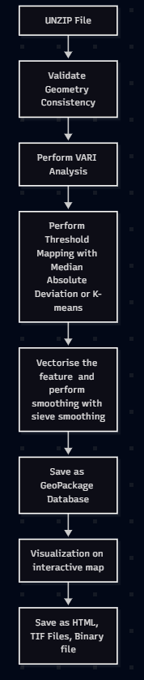
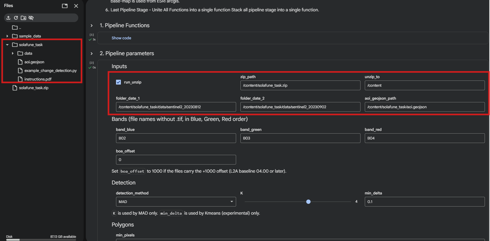
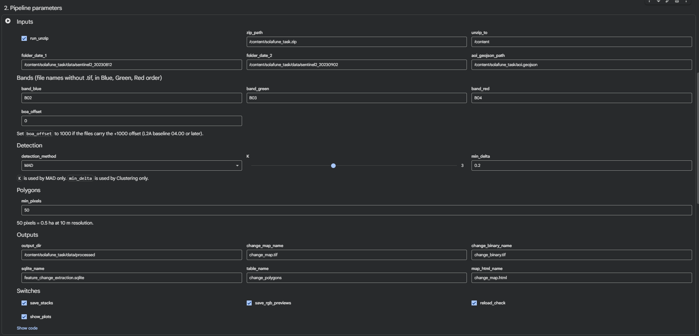
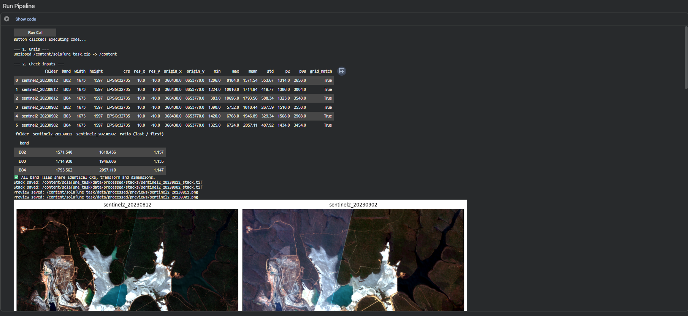
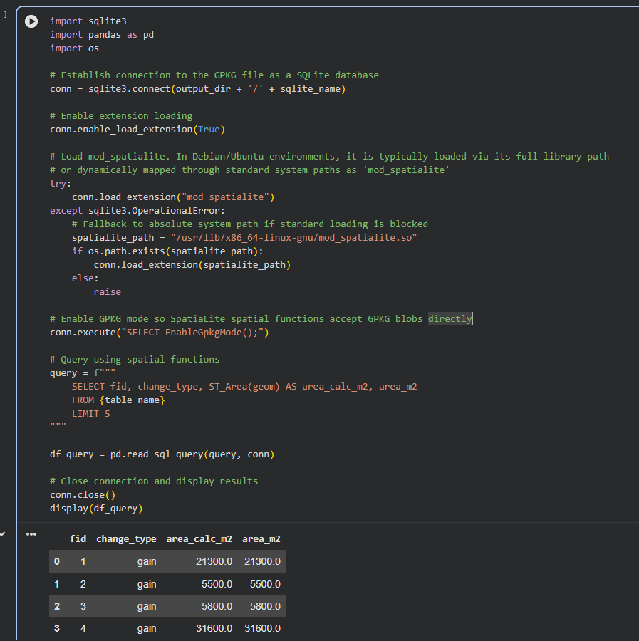

# Solafune Task — Vegetation Change Detection Pipeline

## Table of Contents

- [⚠️ Assumptions](#️-assumptions)
- [Approach](#approach)
  - [Index Choice — VARI](#index-choice--vari)
  - [Pipeline Stages](#pipeline-stages-build-in-mermaid-graph)
    - [Stage 1 — Unzip](#stage-1--unzip)
    - [Stage 2 — Pre-process & Consistency Check](#stage-2--pre-process--consistency-check)
    - [Stage 3 — VARI Change Detection](#stage-3--vari-change-detection)
    - [Stage 4 — Vectorise to Polygons](#stage-4--vectorise-to-polygons)
    - [Stage 5 — Store in GeoPackage (SQLite)](#stage-5--store-in-geopackage-sqlite)
    - [Stage 6 — Interactive HTML Map](#stage-6--interactive-html-map)
- [File Structure](#file-structure)
- [How to Run](#how-to-run)
  - [Option A — Google Colab (Recommended)](#option-a--google-colab-recommended)
  - [Option B — Local Python Script](#option-b--local-python-script)
- [Parameters Reference](#parameters-reference)
- [Outputs](#outputs)
- [Dependencies](#dependencies)

---

## ⚠️ Assumptions

> **Please review these before running the pipeline.**

| # | Assumption |
|---|------------|
| A0 | This assignment result analysis assumes that Sentinel Folders Name are arranged in ascending order by date. Hence, Sentinel2_20230812 is 12 August 2023 and Sentinel2_20230912 is 2 September 2023.|
| A1 | Band files follow Sentinel-2 naming: `B02.tif` (Blue), `B03.tif` (Green), `B04.tif` (Red). Assumes both date folders follow a single naming consistency. *Note: The band names for each band are adjustable in the code.*|
| A2 | Pixel value **zero (0)** will be assumed as no-data / outside the scene. The pixel value will be converted to NaN to avoid distribution error in calculation. |
| A3 | The Sentinel-2 L2A files do **not** carry the +1000 BOA reflectance offset (baseline < 04.00). If your files do carry the offset, set `boa_offset = 1000` in the parameters. |
| A4 | The AOI GeoJSON file (`aoi.geojson`) is assumed to use **EPSG:4326** (WGS84 geographic). |
| A5 | Area calculations (`area_ha`) are only accurate when the band CRS is **metric** (e.g. UTM). If bands are in a geographic CRS (degrees), the pipeline will print a warning but will not stop. |
| A6 | The pipeline is designed to run in **Google Colab** (original environment). Running it locally requires replacing Colab-specific paths (`/content/…`) with local equivalents — see the *Local Execution* section below. The py file is using Google Colab path settings. |
| A7 | The default detection method is **MAD** (`K = 3`). This was chosen as a robust, distribution-free baseline. Clustering (GMM) is available as an alternative but is slower. |
| A8 | This assignment assumes that a feature change from both MAD and Clustering is required to have a minimum of **50 contiguous pixels** (~0.5 ha at 10 m) before converted to a polygon geometry. This filters out single-pixel noise |

---

## Approach

### Index Choice — VARI

The pipeline uses the **Visible Atmospherically Resistant Index (VARI)**:

```
VARI = (Green − Red) / (Green + Red − Blue)
```

**Why VARI?**

Variation in vegetation coverage around open-pit mining is a critical indicator of the environmental impacts of mining operations. Vegetation acts as a natural sentinel, reflecting changes in soil quality, water availability, and air quality caused by mining activities. Monitoring vegetation changes helps identify the extent of ecosystem damage, assess the effectiveness of restoration efforts, and ensure compliance with environmental regulations.

1. Early environmental detection: Identify vegetation loss and environmental damage around mining areas.
2. Monitor mining impacts: Track vegetation changes over time using satellite imagery.
3. Assess land rehabilitation: Check whether vegetation recovers after mining.
4. Protect soil and water: Reduce erosion, runoff, and sediment pollution.
5. Monitor carbon storage and ecosystem recovery: Assess vegetation regrowth and its ability to absorb CO₂.

VARI was chosen over NDVI because it uses only the visible bands (B02, B03, B04) that are provided in the task dataset. It is designed to be less sensitive to atmospheric effects than a simple ratio, making it suitable for comparing two acquisitions taken 21 days apart under potentially different atmospheric conditions.

**References used:**
- https://docs.geopera.com/spectral-indices/vari_visible
- https://pmc.ncbi.nlm.nih.gov/articles/PMC9332278/ (NDVI/VARI for mining change detection)

---

### Pipeline Stages (Build in mermaid graph)


#### Stage 1 — Unzip
Extracts the task ZIP file into a working directory. Controlled by `run_unzip`. Skip if data is already extracted.

#### Stage 2 — Pre-process & Consistency Check
Opens every band file from both dates and verifies that all files share the same CRS, pixel dimensions (`width × height`), and affine transform (origin + resolution). If any mismatch is found the pipeline raises an error with a diagnostic table before doing any processing.

Optional outputs:
- **Stack TIFs**: one 3-band `(Blue, Green, Red)` TIF per date, stored in `processed/stacks/`.
- **RGB previews**: true-colour PNG with a 2–98 percentile stretch per band, stored in `processed/previews/`.

#### Stage 3 — VARI Change Detection
1. Reads bands, subtracts `boa_offset`, divides by 10 000 → reflectance in [0, 1].
2. Computes VARI for each date.
3. Computes the pixel-wise difference: `ΔVARI = VARI₂ − VARI₁`.
4. Removes the **median global shift** from the difference image. This corrects bulk offsets caused by differences in sun angle, haze, or sensor gain between the two dates without needing an atmospheric correction model.
5. Classifies each pixel using one of two methods:

| Method | Parameter | Logic |
|--------|-----------|-------|
| **MAD** (default) | `K` (default 4) | Pixels deviating more than `K × 1.4826 × MAD` are flagged as change. Robust for detecting outliers, in this case, the change is the outlier. `Result from this option doesn't produce confident score` |
| **K-means (experimental)** | `min_delta` (default 0.1) | Fits a 3-component K-means (loss / no-change / gain). Pixels whose absolute ΔVARI is below `min_delta` are forced to no-change. Outputs per-pixel probability scores. *Note: Detail explanation is described in report.md*|

Change classes:
- `1` = vegetation **loss** (ΔVARI < −threshold)
- `2` = vegetation **gain** (ΔVARI > +threshold)
- `0` = no significant change

Raster outputs saved to `output_dir`:
- `change_map.tif` — continuous `|ΔVARI|` intensity (float32)
- `change_binary.tif` — binary changed / unchanged mask (uint8, nodata=255)
- `change_map_proba.tif` — per-pixel loss and gain probabilities (float32, 2-band; Clustering mode only)

#### Stage 4 — Vectorise to Polygons
1. Applies **sieve filtering** (removes clusters smaller than `min_pixels`) to clean up salt-and-pepper noise.
2. Converts the raster change mask to vector polygons using `rasterio.features.shapes`.
3. Computes `area_ha` per polygon.
4. If Kmeans was used, aggregates per-polygon confidence scores (`conf_mean`, `conf_min`) and assigns a confidence class (`low / medium / high`).

#### Stage 5 — Store in GeoPackage (SQLite)
Writes the polygon GeoDataFrame to a **GeoPackage** file (`.gpkg` / `.sqlite`), which is a standard SQLite database with a spatial extension. A `change_type` index is added via raw SQLite to support fast filtering queries.

Optional `reload_check`: re-reads the saved file and verifies row count, CRS, and total area match the in-memory GeoDataFrame.


#### Stage 6 — Interactive HTML Map
Builds a **Folium** map with:
- Satellite basemap (ESRI World Imagery)
- AOI outline (cyan, no fill)
- Loss polygons (red)
- Gain polygons (green)
- Layer toggle control
- Click-to-popup with polygon attributes

Saved as a standalone `change_map.html` that can be opened in any browser.

---

## File Structure

```
solafune/
├── Solafune_Task.ipynb          # Notebook version (primary, for Colab)
├── solafune_task.py             # Python script version (converted from notebook)
├── example_change_detection.py # Minimal standalone example
├── aoi.geojson                  # Area of Interest boundary
├── README.MD                    # This file
├── sentinel2_20230812/          # Band TIFs — date 1
│   ├── B02.tif
│   ├── B03.tif
│   └── B04.tif
└── sentinel2_20230902/          # Band TIFs — date 2
    ├── B02.tif
    ├── B03.tif
    └── B04.tif
```

---

## How to Run
### Option A — Google Colab (Recommended)

1. Open the notebook `Solafune_Task.ipynb`
2. Upload `solafune_task.zip` (the original folder zipped) to Colab's `/content/` directory *you may find it inside the notebook folder* (Adjust the parameter `input_dir` according to the desire path folder). *If the user have the unzip version, then adjust the path folder accordingly, while currently, all data neeeded for processing must under /content/solafune_task/.*

3. In **Cell 1**, run all pipeline functions to define them.
4. In **Cell 2**, adjust parameters as needed (see Parameters table below).

5. In **Cell 3**, click the **"Run Cell"** button widget. The interactive map will appear inline when the pipeline finishes.

6. In **Cell 4**, run the cell to try performing a GIS SQL towards gpkg file.

7. Video is available in `/tutorial_video_notebook/Video Tutorial.mp4`

### Option B — Local Python Script
#### 1. Install dependencies

```bash
pip install -r requirements.txt
```
If you prefer to install manually without `requirements.txt`:

```bash
pip install numpy pandas geopandas fiona rasterio shapely scikit-learn matplotlib folium ipywidgets
```

> **Note:** `rasterio` and `geopandas` require GDAL.
>
> **Optional — Spatial SQL queries (Appendix A only):** The spatial SQLite query in the appendix requires system-level `mod_spatialite`. Install it with:
> ```bash
> sudo apt install libsqlite3-mod-spatialite libspatialite-dev spatialite-bin
> ```

#### 2. Update paths in `solafune_task.py`

Open `solafune_task.py` and edit the **Pipeline parameters** section (around line 453):

```python
# --- Inputs ---
run_unzip        = False                              # Set True only if you have a .zip
zip_path         = "/path/to/solafune_task.zip"
unzip_to         = "/path/to/working/dir"
folder_date_1    = "/path/to/sentinel2_20230812"     # ← adjust to your local path
folder_date_2    = "/path/to/sentinel2_20230902"     # ← adjust to your local path
aoi_geojson_path = "/path/to/aoi.geojson"

# --- Outputs ---
output_dir       = "/path/to/output/processed"
```

#### 3. Run

```bash
python solafune_task.py
```

The script will print progress for each stage and save all outputs to `output_dir`.

> **`show_plots` note:** When running as a plain script (not in a notebook), set `show_plots = False` to disable `matplotlib` pop-up windows, or ensure you have a display available.

---

## Parameters Reference

| Parameter | Default | Description |
|-----------|---------|-------------|
| `run_unzip` | `True` | Extract ZIP before running. Set `False` if already extracted. |
| `zip_path` | `/content/solafune_task.zip` | Path to the source ZIP file. |
| `unzip_to` | `/content` | Destination directory for extraction. |
| `folder_date_1` | `…/sentinel2_20230812` | Directory containing band TIFs for the first (earlier) date. |
| `folder_date_2` | `…/sentinel2_20230902` | Directory containing band TIFs for the second (later) date. |
| `aoi_geojson_path` | `…/aoi.geojson` | AOI boundary file. Optional — map is drawn without it if not found. |
| `band_blue` | `B02` | Filename (without `.tif`) for the blue band. |
| `band_green` | `B03` | Filename (without `.tif`) for the green band. |
| `band_red` | `B04` | Filename (without `.tif`) for the red band. |
| `boa_offset` | `0` | Set to `1000` for L2A baseline 04.00+ files (post-Jan 2022). |
| `detection_method` | `MAD` | `MAD` or `Clustering`. |
| `K` | `3` | MAD sensitivity. Higher = fewer detections. Typical range: 2–5. |
| `min_delta` | `0.2` | Clustering minimum ΔVARI to count as change. |
| `min_pixels` | `50` | Minimum contiguous pixels for a polygon (~0.5 ha at 10 m). |
| `save_stacks` | `True` | Write multi-band stack TIFs to `processed/stacks/`. |
| `save_rgb_previews` | `True` | Write true-colour PNG previews to `processed/previews/`. |
| `reload_check` | `True` | Re-read the saved GeoPackage and verify it matches the in-memory data. |
| `show_plots` | `True` | Display matplotlib figures inline (notebook) or in pop-ups (script). |

---

## Outputs

| File | Description |
|------|-------------|
| `processed/change_map.tif` | Continuous change intensity (\|ΔVARI\|), float32 |
| `processed/change_binary.tif` | Binary change mask (1 = changed, 0 = no change, 255 = nodata) |
| `processed/change_map_proba.tif` | Loss/gain probability per pixel (Clustering only) |
| `processed/stacks/*.tif` | 3-band (BGR) stack per date |
| `processed/previews/*.png` | True-colour preview per date |
| `processed/feature_change_extraction.sqlite` | GeoPackage with change polygons |
| `processed/change_map.html` | Interactive Folium map |

---
