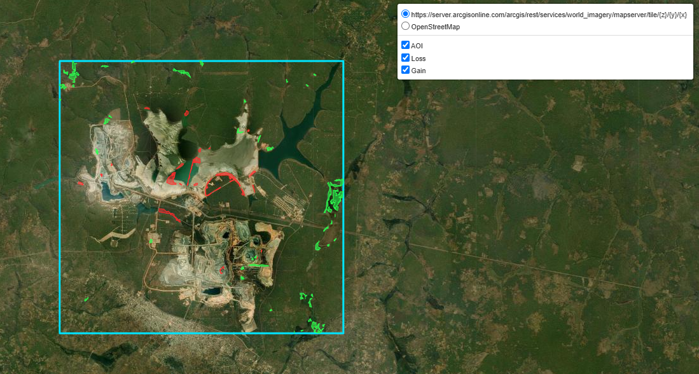
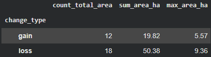
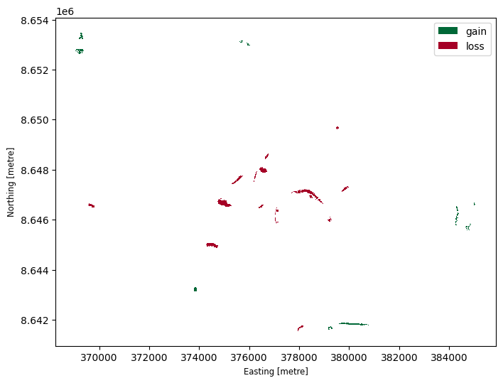
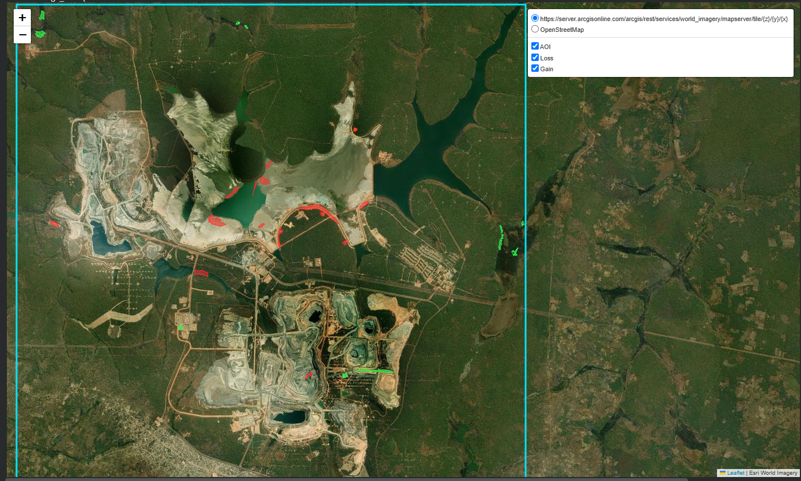
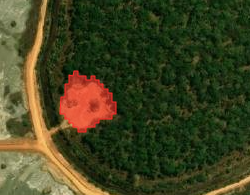
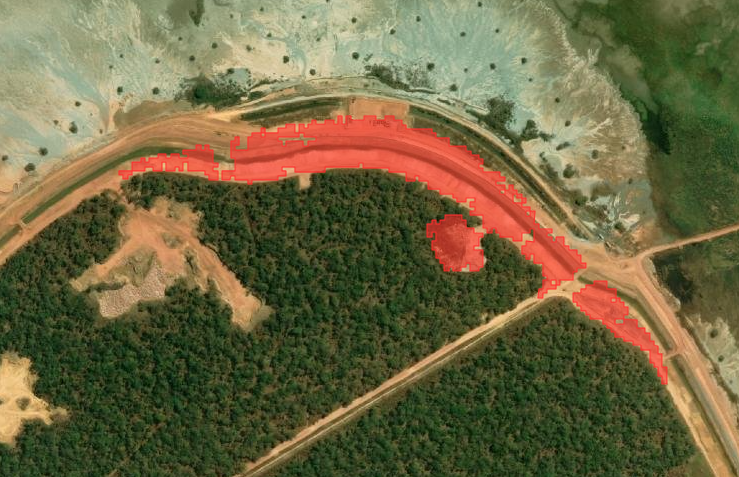
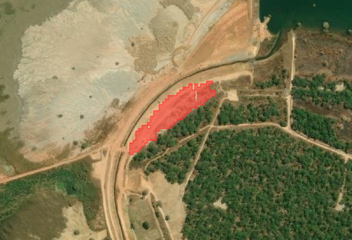
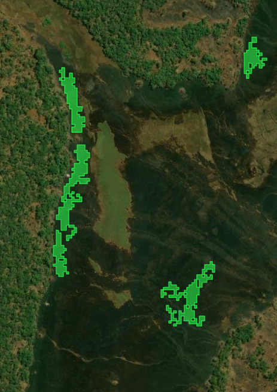
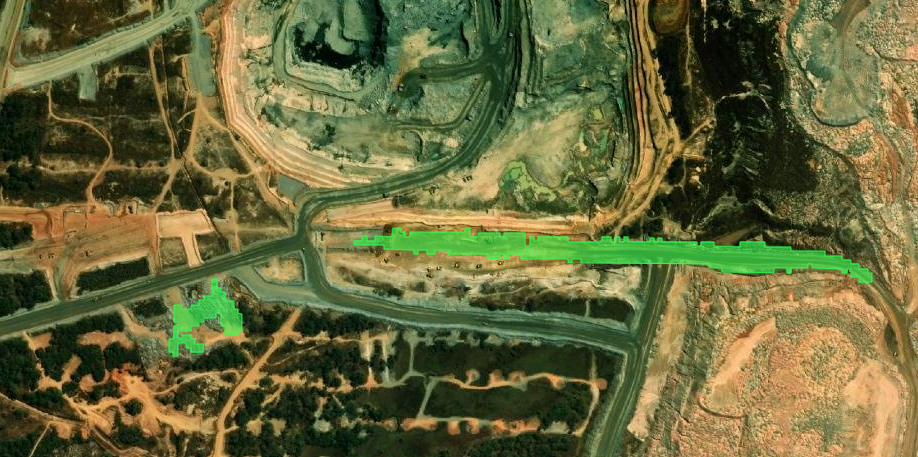

# Sentinel-2 change analysis, open-pit mine in Zambia

> Dates: This assignment assumes data from 12 Aug 2023 and 2 Sep 2023 (not vice-versa). Bands 2, 3, 4, already clipped to the AOI.
>
> Note: This assignment doesn't consider any additional dataset.

Red is loss, green is gain, the light blue box is the AOI. The base-map is Esri World Imagery, which use the latest existing basemap. Hence, there might be slight differences between the base-map and the change detection result.

Disclaimer: The feature change detection is still on development, as some pixels may show changes caused by noise or other factors.

## 1. Method

The result shows the difference in VARI between the two dates as the change feature, then detects pixels that moved more than normal for this scene.

The steps:

1. Read the bands for both dates, check that CRS, transform and size consistent, and save a 3-band stack for each date.
2. Subtract the BOA offset, divide by 10,000, treat 0 as nodata (Offset -1000 is for Level-2A (BOA), the code assumes no offset needed as the default state zero values)
3. Compute VARI = (G - R) / (G + R - B) per date. Pixels where the denominator is close to zero are masked, and values are clipped to [-1, 1].
4. Subtract date 1 from date 2, then remove the median of that difference. This takes out a global brightness or haze shift between the two acquisitions. It assumes most of the scene did not change.
5. Classify the difference. There are two options in the code:
   - MAD: flag anything further than K * 1.4826 * MAD from the median. Negative is loss, positive is gain.
   - K-means with 3 components (loss, no change, gain). Pixels with |diff| below `min_delta` are set back to no change. This one also gives a probability per pixel, which I average per polygon as a confidence value.
6. Remove clusters smaller than `min_pixels` with a sieve filter (8-connectivity), then vectorise what is left into polygons with type and area.
7. Save the polygons to a GeoPackage and draw a Folium map with the AOI outline and separate loss/gain layers.

The map above comes from: `K-means`, with `K = 4 with min_pixels = 50`.

### 1a. Why VARI?

> Why did I use VARI (Visible Atmospherically Resistant Index) analysis for this project? 

> Although this test is designed to assess candidates’ engineering skills, I also want to emphasize that research-driven analytics can provide practical, actionable insights.
> Variation in vegetation coverage around open-pit mining is a critical indicator of the environmental impacts of mining operations.
>1. Early environmental detection: Identify vegetation loss and environmental damage around mining areas.
>2. Monitor mining impacts: Track vegetation changes over time using satellite imagery.
>3. Assess land rehabilitation: Check whether vegetation recovers after mining.
>4. Protect soil and water: Reduce erosion, runoff, and sediment pollution.>
>5. Monitor carbon storage and ecosystem recovery: Assess vegetation regrowth and its ability to absorb CO₂.
>
> Research Journals Reference:
> - https://docs.geopera.com/spectral-indices/vari_visible
> - https://pmc.ncbi.nlm.nih.gov/articles/PMC9332278/ (NDVI/VARI for mining change detection)
> - https://jointherivercoalition.org/why-open-pit-mining-devastates-the-environment/

### 1b. Why did I use Median Absolute Deviation (MAD) option for change detection threshold?

> Median Absolute Deviation (MAD) is a common practice to detect the outliers or anomaly in the data. Unlike mean or standard deviation which heavily influenced by outlier, MAD is the alternatives by using 2x-5x value than MAD will detect the outlier (https://crispinagar.github.io/blogs/mad-anomaly-detection.html). In this case, the outlier is the change pixel, while the no-change filter is the background. Then, the author just need to adjust the value of `K`. The higher `K` value will remove most of the change, to low will include many semi-change pixels. It is recommended to use K value within the range of 2-5.
> 

### 1c. Why did I use K-means as experimental clustering option?

> K-means is a widely used clustering method to group elements based on their similar behaviour. The author thinks that clustering method able to perform better than statistical threshold in some cases. 
>
> Based on the article (https://pmc.ncbi.nlm.nih.gov/articles/PMC13043781/) demonstrates that combining K-means clustering with NDVI,MNDWI and Raw NIR Band can reduce classification errors in vegetation-related satellite imagery. However, K-means is still an experimental since the available analysis for this assignment limited to VARI (with RGB), hence, in the future where B8 is available, NDVI, NDWI, NGRDI, SAVI, and VARI can be used together with K-means for better result.

One limit to keep in mind: after a statistical threshold, this detects "changed more than usual", not vegetation as such. A drop in VARI is consistent with less green, but dust, exposed soil or shadow can do the same thing. So, the assignment will read the result as change detection first and only then guess at causes.

## 2. Results

Summary statistics of Loss and Gain derive from the analysis:
>

Map Result by VARI analysis of Gain and Loss using Median Absolute Deviation (MAD) with K = 4:
>

> - Loss is more than gain and most of it is concentrated in the middle of the AOI. The red polygons cluster around the central mine area. The main ones are two compact blocks near Easting 375,000-377,000 and Northing 8.6465-8.648M, a long curved strip with a straight edge at about 378,000-380,000, and another curved strip at about 374,000-376,000, Northing 8.6445M. These look like engineered or bare-surface changes (earthworks, deposition, wet/dry surface), not vegetation.
> - Gain is more scattered and mostly on the outside. Green polygons are ragged and patchy That fits seasonal greening of the woodland around the mine, or edge effects. The small green specks in the interior are likely noise.
> - The floor makes the map conservative. With K = 4, any pixel whose VARI changed by `less or more` 4x Median Absolute Deviation (MAD) value was forced to “no change”. That is why the map is sparse and only strong changes survive. A lower floor would add many weak, probably noisy polygons around the existing ones.
> - Shape tells real change from noise. Compact or long straight-edged loss polygons are more believable than thin, fragmented green ones.
> - *Main caveat: a drop in VARI doesn’t prove 100% of vegetation loss or gain due to shadow, haze, or unstable ratios on bright bare ground can cause it too.*

## 3. Interpretation

> **Note:** The following is an interactive map showing the vegetation losses and gains in the study site. The insight is derived from the assumption that Sentinel2_20230812 is ealier than Sentinel2_20230902. Hence, any losses in pixel would be considered as vegetation loss and vice-versa. In addition, the result is based on VARI analysis combine with MAD with K = 4 (4x threshold).

The intention of this assignment is to highlight the loss of vegetation around the mining area. However, due to un-available Band 8 dataset, VARI is used to replace NDVI, it might cause inaccuracies in the vegetation detection.
Nevertheless, it managed to detect the losses such as vegetation loss in several areas (already double checked with the raw stacked png files data):
> `Vegetation Loss Detected`
1. Singnificant Change happened in this section probably for the mining area expansion.

2. There are road expansion happened in this area, looking at the picture probably it's road passed by heavy vehicle causing vegetation loss. 
3. Similar to the above, expansion of road network with clearing the vegetation nearby the road.

> `Vegetation Gain Detected`
4. In this image, we could see the greener area gets greener detected. 
5. Though this probably due to the shadow or noise, but it's detected as vegetation gain, indicating that there might be some improvement of the vegetaion in that area. However, since B8 is missing, hence, this can't be proven. 

Conclusion: The VARI combine with Median Absolute Threshold (MAD) with K = 4 (only taking VARI Band Difference above or below 4x MAD Threshold) able to distinguish the differences between Sentinel2 12-08-2023 to 02-09-2023 in the study site. In addition, the Vegetation loss detected in the study site might be due to the expansion of the mining area and the expansion of the road network. The government could use this platform to track the vegetation losses due to mining activities and enforce the mitigation measures to ensure the sustainability of the environment. For instance, government only allows the mining company to keep 60% vegetation intact. This platform enable government to track the vegetation losses plus gain. The government also can use this platform to monitor the success of re-vegetation progamme in the region. In addition, as a platform for stakeholders to monitor the vegetation changes in the region.

## Limitations

- Visible bands only. No NIR or SWIR, so no NDVI, no bare-soil or moisture index.
- No cloud or shadow mask, and I have not confirmed whether the scenes are L2A or L1C, which decides whether the BOA offset is right. The assumption is no BOA Offset requires yet in the pre-processing of the dataset. However, BOA offset parameter is already included in the code.
- No accuracy figures, only visual checks.
- K, `min_delta` and `min_pixels` were picked best on the given dataset as I didn't run for sensitivity analysis to automate K, min_delta and min_pixels yet.
- The author tried to extract new Band, however, the extraction process are not successful and it requires further investigation especially for the date. The author found if the sentinel2_20230812 is extracted on 12 Aug 23, there's no data in either Copernicus or Planetary Data. If it's extracted on 8 December 2023, the data only shows partial of the AOI.

## Next steps

> The most useful addition would be a second feature that sees brightness changes, such as the distance across all three bands, because VARI barely reacts to new roads or dump faces on bare ground. After that: a per-band gain/offset normalisation on unchanged pixels, a cloud and shadow mask from the SCL band, and a check of 10 to 20 polygons against higher-resolution imagery.
>
> Second Idea is to enrich the Band tif files with additional dataset which provides more complete data on selected timestamp. If 8/12/2023 or 12/8/2023 data is unavaiable, the author suggest to pick another date to enrich the analysis.
> 
> Third idea is to develop a monthly chart to monitor vegetation changes percentage track vegetation loss caused by mining activities, ensuring compliance with government contract requirements.